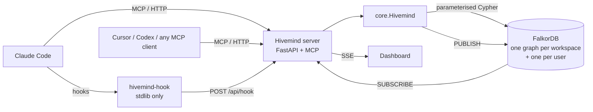

# Architecture and design decisions

This document explains how Hivemind works and why it is built this way. The second half is a Q&A of the questions judges are likely to ask.

## The moving parts

- **`core.Hivemind`** holds every operation. The MCP server, hooks, REST API, demo and benchmarks are thin layers on top. Each call takes an `Actor` (workspace, user, agent, session), so one process serves many agents and tenants.
- **`queries.py`** holds every Cypher query. Nothing else talks to the database with free-form Cypher.
- **The server** keeps the embedding model warm. Hooks are a tiny stdlib HTTP client, so a hook costs 0.3–0.5 s instead of a 2 s model load.
- **Live updates** use Redis pub/sub on the same FalkorDB instance. Any process that writes memory publishes an event, and the dashboard streams it.

## Memory model

| Kind | Node | How it's written | How it's read |
|---|---|---|---|
| Episodic | `Episode` | Hooks (prompts, replies, commands, errors); the `remember` tool | Vector search, chronological `history`, `NEXT` chains |
| Semantic | `Fact` | The `learn` tool; promotion from private memory | Hybrid recall (vector + full-text + graph hops), time-filtered |
| Procedural | `Procedure` | Mined automatically from fail → fix → success; the `record_procedure` tool | `find_procedure`, the session briefing, the moment of failure |
| Coordination | `Task`, `Handoff`, `TOUCHED` | `claim_task`, `handoff`; hooks on edits | `inbox`, `team_status`, conflict warnings |

### Facts are bi-temporal and never overwritten
- **`valid_from` / `valid_to`:** when the fact was true.
- **`recorded_at`:** when the team learned it.
- **Updating:** a new fact with the same `key` sets `valid_to` on the old one and links `(new)-[:SUPERSEDES]->(old)`.
- **Time travel:** recall at `as_of = T` returns facts with `recorded_at <= T AND valid_from <= T AND (valid_to IS NULL OR valid_to > T)`.

### Deduplication and contradictions
Before a fact is written, Hivemind searches for similar active facts:
- **Similarity ≥ 0.93:** the same fact said again. The existing fact is *reinforced*: confidence goes up, and a `LEARNED_BY` edge is added for the new agent.
- **0.82 to 0.93:** returned to the agent as `possible_conflicts`, so it can call `supersede`.

The thresholds are calibrated for `bge-small-en-v1.5`, where unrelated English sentences sit around 0.55–0.65 cosine similarity.

### Provenance is guaranteed
Every fact has a `LEARNED_FROM` edge to an episode. If an agent calls `learn` directly, Hivemind first records a "learning" episode in that session. `why(id)` therefore always reaches a session, an agent and a human.

### Procedure mining (`hooks.py`)
1. A Bash command fails. The session stores `fail_key = command_key(cmd)` (so `uv run pytest -q` becomes `pytest`).
2. Later commands that change state (not `ls`, `cat`, `git status` and so on) are collected as candidate steps.
3. When a command with the same key succeeds, the steps plus the successful command become a `Procedure`, linked to both the failure and success episodes. Same steps again (after normalisation) reinforce it; different steps create a revision (`REVISES`).

### The known fix at the moment of failure
On `PostToolUseFailure`, Hivemind looks up three things:
- procedures for the same command entity (or with a near-identical goal) that have succeeded more often than failed
- facts semantically close to the error's root-cause line, extracted by `error_signature`, which skips test-runner summaries
- whether other agents hit the same error before

These are added to the error as `additionalContext`. Strict thresholds keep false hints out; the tests check that the very first failure gets *no* hint.

## Concurrency and tenancy

- **Write serialisation is per graph.** FalkorDB applies writes to one graph one at a time, in arrival order, while reads run in parallel on snapshots. Hivemind relies on that:
  - Every write is one atomic Cypher query, with no multi-query transactions and no `MULTI/EXEC`, which would block every graph.
  - The task claim is a single compare-and-set query, so N agents racing produce exactly one winner, with no locks in Python.
  - Reads use `GRAPH.RO_QUERY`.
- **One graph per workspace, plus one per user.** Tenants are isolated physically, not by a `WHERE tenant = …` filter, so a missing filter can't leak data. It also suits vector search, which doesn't combine well with property filters: inside a tenant's graph, every vector hit is already that tenant's. And writes to different graphs don't queue behind each other; the benchmark shows 18% more throughput at 100 agents.

## Ranking a recall

For each candidate:
- `semantic` = 1 − cosine distance from the vector index
- `keyword` = normalised full-text (TF-IDF) score
- `graph_hops` = 0 if the fact is about an entity named in the query, 1 if about a neighbour, otherwise none

| Type | Score |
|---|---|
| Fact | `0.6·semantic + 0.15·keyword + 0.15·graph + 0.05·confidence + 0.05·importance` |
| Procedure | `0.65·semantic + 0.15·graph + 0.2·success_rate`, where success rate is Laplace-smoothed: (s+1)/(s+f+2) |
| Episode | `0.85·(0.75·semantic + 0.25·recency)`, where recency decays with a 7-day time constant |

A candidate with *only* a weak semantic match (below 0.68, with no keyword or graph signal) is dropped. That's how "not in the graph" comes out honestly.

## Graph algorithms

Consolidation runs every 5 minutes and from the Consolidate button:

1. **PageRank** (`algo.pageRank('Entity','RELATES_TO')`) writes `centrality` on each entity: files and tools many others relate to are load-bearing.
2. **Fact importance** is computed from max centrality of the entities it's about, the number of agents that independently learned it, uses, and confidence. It ranks the briefing.
3. **Topics** come from weakly connected components (`algo.WCC`). Components larger than 25 entities are split with label propagation (`algo.labelPropagation`). Label propagation alone oscillates on small star-shaped graphs, which is why components come first.
4. **Archiving** marks old, low-value episodes that nothing derives from as forgotten.

`connect(a, b)` uses `algo.SPpaths` to explain how two things are related.

## Security

- **Secrets are redacted before anything is embedded or stored** (see `text.redact`).
- **Hard delete** removes an episode plus facts and procedures whose *only* provenance was that episode (a right-to-be-forgotten path).
- **The API key** protects MCP and hooks. The demo endpoint refuses any workspace except `demo`.

---

# Q&A for judges

**Why a graph database, not a vector store?**
The questions agents need answered are about connections:
- Who learned this, and from what?
- What replaced it?
- Who's editing this file right now?
- Which handoff carried which facts?
- What does this error have to do with that procedure?

Vectors find *similar text*. The graph answers *how things relate*, and FalkorDB gives us both in one query, for example vector search followed by a provenance traversal.

**What would break without FalkorDB?** Everything:
- provenance (`WHY`)
- time travel (filtering on temporal properties during vector search)
- atomic claims (per-graph write serialisation)
- tenant isolation (multi-graph)
- topics (WCC and label propagation)
- importance (PageRank)
- live events (pub/sub)

The graph *is* the product.

**Why do agents not write Cypher?**
Safety and reliability. The agent picks from 22 typed tools; each runs a fixed, parameterised query. There's no injection surface, and every query is reviewed and indexed.

**Why separate graphs instead of a tenant property?**
Isolation by construction, faster vector search per tenant, and parallel writes across tenants. FalkorDB is designed to hold thousands of graphs in one instance.

**How do you keep memory from going stale?**
- Facts with a `key` supersede automatically.
- Near-contradictions are surfaced to the agent.
- Procedures are ranked by smoothed success rate, and agents `report_outcome`.
- Old, unreferenced episodes are archived.
- Time travel lets you see what changed.

**How do you avoid false "known fix" hints?**
Fixes are only offered when:
- a procedure is *for the same command entity*, or near-identical in goal, and has succeeded more than failed; or
- a fact is close to the error's *root-cause line*, not just the command name.

There's a test asserting that the first-ever failure gets no hint.

**Is the claim really race-free?**
Yes. The `WHERE` check and the `SET` are in one query, and FalkorDB serialises writes per graph. Measured: 100 agents × 20 trials, exactly one winner every time. There is also a 25-agent test in the suite.

**How does the hook stay fast and safe?**
`hivemind-hook` is stdlib-only and posts to the running server, which has the model warm. Any error, or the server being down, means exit 0 with no output: memory never blocks an agent.

**Why local embeddings?**
`bge-small-en-v1.5` via fastembed runs in about 15 ms per text with no API key, so a team can run Hivemind fully self-hosted. Tests and benchmarks use a deterministic hash embedder.

**What's the biggest limitation?**
Memory quality depends on what agents record. Procedure mining only sees shell commands; edits made between a failure and a success aren't captured as steps. Next steps would be capturing edit diffs as steps and an optional LLM pass to extract facts from transcripts.

**What would you build next?**
- Per-workspace access control on the dashboard.
- Capturing file edits inside mined procedures.
- Memory export and import.
- Native hooks for Cursor and Codex as their hook APIs mature.
- Using FalkorDB's betweenness centrality to flag knowledge bottlenecks: the one agent or person who knows something nobody else does.
